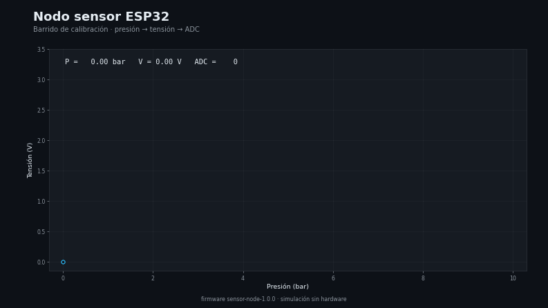

# Capa 4 — I+D y prototipado (firmware)

[`lazarolpro/nodo-sensor-esp32`](https://github.com/lazarolpro/nodo-sensor-esp32) · parte del [portafolio de 9 capacidades](https://github.com/lazarolpro/portafolio)

**Capacidad demostrada:** llevar una idea a un prototipo de firmware ejecutable y
simulable, sin gastar en hardware.

> © 2026 Ronny L. Díaz López. **Todos los derechos reservados.** El código fuente,
> los datos de detalle y los informes completos son propiedad del autor y no se
> publican. Prohibida su venta o uso comercial sin autorización escrita. Ver
> [`LICENSE`](LICENSE).

## Problema real

Prototipar un nodo sensor suele exigir comprar componentes y montar el circuito
para saber si la idea funciona. Con firmware + simulación se valida el lazo
sensor → conversión → publicación antes de invertir.

## Qué hace

- Lee un sensor analógico de presión en un **ESP32** y lo convierte a unidades de
  ingeniería.
- Publica lecturas estructuradas (JSON) listas para integrar.
- Simula la curva completa (presión → tensión → ADC) sin hardware.

## Demo visual

La animación dibuja el barrido completo presión → tensión → ADC. Video completo:
[`assets/sensor_demo.mp4`](assets/sensor_demo.mp4).

## Evidencia que produce

- `assets/sensor_demo.mp4`, `sensor_demo.gif`, `sensor_demo_poster.png` — demo visual
  animado (con miniatura).
- [`assets/muestra_sensor.pdf`](assets/muestra_sensor.pdf) — muestra resumida con
  el barrido de calibración del sensor (con marca de agua).
- [`sim/sample_output.jsonl`](sim/sample_output.jsonl) — salida de la simulación
  (lecturas del barrido).
- [`wokwi/diagram.json`](wokwi/diagram.json) — esquema del circuito simulado.

## Alcance de este repositorio

Este repositorio es una **vitrina del resultado**: muestra el barrido de
calibración, la salida de la simulación y el esquema del circuito. El **firmware
fuente**, el **código de simulación** y los **informes completos** son propiedad
del autor y se mantienen fuera del repositorio público.

## Stack

ESP32/Arduino (C++) y simulación con Python 3. *(El código no se publica; ver
`LICENSE`.)*

## Por qué le importa a la empresa

Demuestra **I+D y prototipado** con costo cero de hardware: de la idea a una
demo funcional y compartible.

**En mantenimiento:** prototipar un sensor o un lazo de control antes de comprar
el hardware definitivo.
